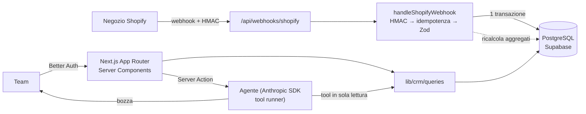

# Order Hub

🌐 [English](README.md) · [Português](README.pt-BR.md) · **Italiano**

**Shopify → CRM con un agente IA per la retention.** Riceve gli ordini di un negozio Shopify
tramite webhook, li salva in PostgreSQL con Prisma, calcola le metriche CRM di ogni cliente (LTV,
scontrino medio, segmento _nuovo / ricorrente / a rischio_) e offre un agente IA che risponde a
domande come _"quali clienti sono a rischio? scrivimi una mail di riattivazione"_ interrogando il
database con il tool calling, restituendo sempre bozze da far revisionare a una persona.

[](https://github.com/fsemilia/order-hub/actions/workflows/ci.yml)


**Demo live:** https://order-hub-lime.vercel.app (Vercel `gru1` + Supabase San Paolo, dati demo; credenziali su richiesta).

> Progetto costruito per approfondire Prisma in produzione e l'ecosistema dei webhook Shopify, con
> il rigore di un sistema reale: idempotenza, transazioni, test automatici, CI, autenticazione e
> LGPD (la legge brasiliana sulla protezione dei dati).

---

## Funzionalità

| Area                | Cosa fa                                                                                                                                                                                                                                                            |
| ------------------- | ------------------------------------------------------------------------------------------------------------------------------------------------------------------------------------------------------------------------------------------------------------------ |
| **Webhook Shopify** | `orders/create`, `orders/updated`, `orders/paid`, `orders/cancelled`, `customers/create`, `customers/update`, `customers/redact`. HMAC verificato sul body grezzo, idempotenza tramite `X-Shopify-Webhook-Id`, una sola transazione, eventi fuori ordine scartati. |
| **CRM**             | LTV e scontrino medio per cliente (con `current_total_price`, che riflette già i rimborsi), segmentazione nuovo / ricorrente / a rischio / senza acquisti, filtri e ricerca lato server.                                                                           |
| **Dashboard**       | Fatturato ultimi 30/90 giorni, scontrino medio, distribuzione per segmento, prodotti più venduti.                                                                                                                                                                  |
| **Agente IA**       | Claude con 3 tool in sola lettura, minimizzazione dei dati personali, quota per utente, log di token e tool in `agent_runs`.                                                                                                                                       |
| **Autenticazione**  | Better Auth: email/password senza registrazione pubblica + GitHub OAuth opzionale con allowlist; rate limit sul login.                                                                                                                                             |
| **LGPD**            | `customers/redact` anonimizza il cliente e conserva solo lo storico economico anonimo; l'LLM non riceve mai email né telefono.                                                                                                                                     |

L'interfaccia è in portoghese brasiliano: è pensata per un team di e-commerce brasiliano.

## Architettura



Dettagli in [`docs/it/architecture.md`](docs/it/architecture.md) e nelle decisioni registrate in
[`docs/it/adr/`](docs/it/adr).

## Stack

| Livello    | Scelta                                                                    | Perché                                                                                               |
| ---------- | ------------------------------------------------------------------------- | ---------------------------------------------------------------------------------------------------- |
| Framework  | **Next.js 16** (App Router, Cache Components, `proxy.ts`)                 | Front e back end in un solo deploy; i Server Components interrogano il database senza API intermedie |
| Linguaggio | **TypeScript strict** + **Zod 4**                                         | Tipi dal database al componente; validazione di env, payload e Server Actions                        |
| Database   | **PostgreSQL** (Supabase, regione San Paolo)                              | Relazionale, transazioni, `Decimal` per il denaro                                                    |
| ORM        | **Prisma 7** (driver adapter `pg`)                                        | Schema dichiarativo, migrazioni versionate, client tipizzato                                         |
| Auth       | **Better Auth**                                                           | Sessioni nel nostro database tramite l'adapter Prisma, nessun vendor lock-in                         |
| IA         | **Anthropic SDK** (tool runner, Claude)                                   | Tool calling tipizzato con Zod, fallback lato server in caso di rifiuto                              |
| UI         | **Tailwind CSS 4**                                                        | Veloce, coerente, dark mode                                                                          |
| Test       | **Vitest** (unit + integrazione su Postgres reale) · **Playwright** (E2E) | Una piramide di test che copre il percorso critico                                                   |
| CI/CD      | **GitHub Actions** + **Vercel** (`gru1`)                                  | Lint, tipi, 3 suite di test e build a ogni PR; preview per ogni PR                                   |

## Avvio in locale

Requisiti: Node 22+ e npm. **Docker non serve**: il Postgres locale è `prisma dev`.

```bash
git clone https://github.com/fsemilia/order-hub && cd order-hub
npm install
cp .env.example .env              # genera BETTER_AUTH_SECRET: openssl rand -base64 32
npm run db:dev                    # avvia il Postgres locale (porta 51214)
npx prisma migrate deploy         # crea le tabelle
npm run db:seed                   # 160 clienti, ~440 ordini e l'utente demo
npm run dev                       # http://localhost:3000
```

Login demo: `demo@orderhub.dev` / il valore di `DEMO_PASSWORD` nel `.env`.

Simula un webhook Shopify firmato, senza un negozio reale:

```bash
npm run webhook:send                                   # orders/create
npm run webhook:send -- --repeat 2                     # stesso webhook 2 volte → {"duplicate":true}
npm run webhook:send -- --topic orders/updated --status refunded
```

Per collegare un vero development store: [`docs/it/shopify-setup.md`](docs/it/shopify-setup.md).
Per pubblicare su Vercel con Supabase: [`docs/it/deploy.md`](docs/it/deploy.md).

## Test

```bash
npm run check             # lint + typecheck + unit test (40)
npm run db:test:start     # Postgres separato per i test
npm run test:integration  # pipeline dei webhook e query su database reale (21)
npm run test:e2e          # Playwright: login, filtri, dettaglio, logout (8)
```

I test di integrazione coprono i casi che rompono le integrazioni in produzione: consegna
duplicata, webhook fuori ordine, rimborso parziale e totale, annullamento, checkout senza cliente,
payload non valido (rollback) e anonimizzazione LGPD.

## Scelte di ingegneria

- **Il denaro non è mai un `float`**: `Decimal(12,2)` nel database, centesimi interi in JS.
- **Aggregati ricalcolati, non incrementati**: ogni scrittura di un ordine ricalcola LTV e conteggio
  del cliente nella stessa transazione, così riconsegne, rimborsi ed eventi fuori ordine convergono.
- **Segmento calcolato al momento della query**: dipende da "oggi", quindi non viene salvato; la
  stessa regola esiste come funzione pura (`segmentOf`) e come filtro Prisma (`segmentWhere`),
  entrambe testate.
- **Autorizzazione vicino ai dati**: `proxy.ts` fa solo il controllo ottimistico del cookie; ogni
  pagina, Server Action e route valida la sessione con `requireUser()`.
- **IA con revisione umana**: l'agente non scrive nel database e non invia nulla; le risposte sono
  bozze modificabili e ogni esecuzione viene registrata con token, tool e latenza.

## Limiti noti

I compromessi consapevoli e le lacune note (un solo negozio, webhook sincroni, rate limit per
istanza, due webhook di privacy solo confermati, agente senza valutazione automatica,
particolarità di `prisma dev` in locale e altro) sono elencati, ciascuno con la sua soluzione, in
[`docs/it/limitations.md`](docs/it/limitations.md).

## Struttura

```text
app/
  (app)/            pagine autenticate: panoramica, clienti, agente
  api/              webhook Shopify, Better Auth, health check
  login/
lib/
  shopify/          hmac, schemi Zod, ingestione idempotente, pipeline dei webhook
  crm/              regole dei segmenti, aggregati, query
  agent/            tool, prompt, esecuzione
prisma/             schema, migrazioni, seed
tests/              unit · integration · e2e · fixtures
docs/               en · pt-BR · it — architettura, ADR, setup Shopify, deploy, agente, limiti
.claude/            skill, subagente revisore e hook di Claude Code
```

## Sviluppo con l'IA

Il repository è predisposto per Claude Code: [`CLAUDE.md`](CLAUDE.md) con le invarianti del
progetto, skill per i compiti ricorrenti (nuovo topic webhook, migrazione Prisma, tool
dell'agente, apertura PR, integrazioni brasiliane), un subagente revisore e hook che formattano il
codice e bloccano le modifiche a `.env`, alle migrazioni applicate e al codice generato. Tutto il
codice generato passa per una revisione critica e per i test prima del merge.

## Prossimi passi

- Coda (Inngest/QStash) tra ricezione ed elaborazione dei webhook, per i picchi di traffico
- Import degli ordini storici tramite Admin GraphQL API
- Canali brasiliani: Mercado Livre, Bling e conferma Pix (note in `.claude/skills/br-ecommerce-integrations`)
- Coorti di riacquisto e RFM; invio delle bozze approvate allo strumento di email marketing

## Licenza

MIT. Vedi [LICENSE](LICENSE).
