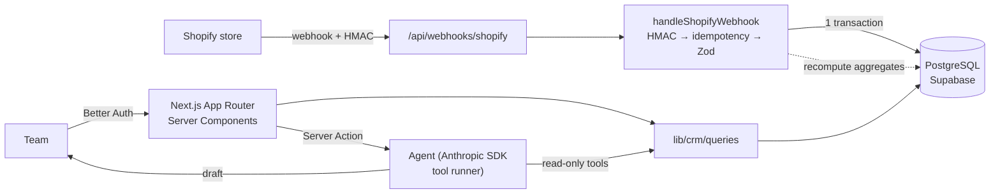

# Order Hub

🌐 **English** · [Português](README.pt-BR.md) · [Italiano](README.it.md)

**Shopify → CRM with an AI retention agent.** Receives orders from one or more Shopify stores through webhooks,
stores them in PostgreSQL with Prisma, computes each customer's CRM metrics (LTV, average ticket,
segment _new / repeat / at risk_) and offers an AI agent that answers questions like _"which
customers are at risk? write me a win-back email"_ by querying the database through tool
calling, always returning drafts for human review.

[](https://github.com/fsemilia/order-hub/actions/workflows/ci.yml)


**Live demo:** https://order-hub-lime.vercel.app (Vercel `gru1` + Supabase São Paulo, demo data; credentials on request).

> Built to go deep on Prisma in production and on Shopify's webhook ecosystem, with the rigor of
> a real system: idempotency, transactions, automated tests, CI, authentication and LGPD (Brazil's
> data protection law).

---

## Features

| Area                 | What it does                                                                                                                                                                                                                                                                                    |
| -------------------- | ----------------------------------------------------------------------------------------------------------------------------------------------------------------------------------------------------------------------------------------------------------------------------------------------- |
| **Shopify webhooks** | `orders/create`, `orders/updated`, `orders/paid`, `orders/cancelled`, `customers/create`, `customers/update`, `customers/redact`, `checkouts/create`, `checkouts/update`. HMAC verified on the raw body, idempotency by `X-Shopify-Webhook-Id`, one transaction, out-of-order events discarded. |
| **CRM**              | LTV and average ticket per customer (using `current_total_price`, which already reflects refunds), segmentation new / repeat / at risk / no purchases, server-side filters and search.                                                                                                          |
| **Dashboard**        | Revenue for the last 30/90 days, average ticket, segment distribution, best sellers.                                                                                                                                                                                                            |
| **AI agent**         | Claude with 4 read-only tools, bound to the current store, personal data minimization, bring-your-own Anthropic key (the server key only for owners), quota on the server key, token and tool audit log in `agent_runs`.                                                                        |
| **Authentication**   | Better Auth: email/password with no public sign-up + optional GitHub OAuth with an allowlist; login rate limit.                                                                                                                                                                                 |
| **LGPD**             | `customers/redact` anonymizes the customer and keeps only the anonymous revenue history; the LLM never receives email or phone.                                                                                                                                                                 |
| **Multi-store**      | Demo data and real Shopify stores side by side: per-store data and webhook secret (encrypted with AES-256-GCM), store switcher in the header, "Demo data / Real store" toggle at login, Stores page to connect stores.                                                                          |
| **Orders**           | Live order feed (refreshes every 15 s) with status filter (paid, pending, refunded, cancelled), search by order number or customer, and the latest orders on the dashboard.                                                                                                                     |
| **Abandoned carts**  | `checkouts/*` webhooks, list with recovery link, 7-day KPI on the dashboard, agent tool for recovery messages.                                                                                                                                                                                  |
| **Languages**        | UI in English (default), Portuguese and Italian; money and dates formatted with `Intl` in the store currency; the agent answers in the UI language.                                                                                                                                             |

## Architecture



Details in [`docs/en/architecture.md`](docs/en/architecture.md) and in the decision records in
[`docs/en/adr/`](docs/en/adr).

## Stack

| Layer     | Choice                                                                  | Why                                                                                                |
| --------- | ----------------------------------------------------------------------- | -------------------------------------------------------------------------------------------------- |
| Framework | **Next.js 16** (App Router, Cache Components, `proxy.ts`)               | Front and back end in one deploy; Server Components query the database without an intermediate API |
| Language  | **TypeScript strict** + **Zod 4**                                       | Types from database to component; validation of env, payloads and Server Actions                   |
| Database  | **PostgreSQL** (Supabase, São Paulo region)                             | Relational, transactions, `Decimal` for money                                                      |
| ORM       | **Prisma 7** (`pg` driver adapter)                                      | Declarative schema, versioned migrations, typed client                                             |
| Auth      | **Better Auth**                                                         | Sessions in our own database through the Prisma adapter, no vendor lock-in                         |
| AI        | **Anthropic SDK** (tool runner, Claude)                                 | Typed tool calling with Zod, server-side refusal fallback                                          |
| UI        | **Tailwind CSS 4**                                                      | Fast, consistent, dark mode                                                                        |
| Tests     | **Vitest** (unit + integration on real Postgres) · **Playwright** (E2E) | A test pyramid that covers the critical path                                                       |
| CI/CD     | **GitHub Actions** + **Vercel** (`gru1`)                                | Lint, types, 3 test suites and build on every PR; preview per PR                                   |

## Running locally

Requirements: Node 22+ and npm. **No Docker needed**: local Postgres is `prisma dev`.

```bash
git clone https://github.com/fsemilia/order-hub && cd order-hub
npm install
cp .env.example .env              # BETTER_AUTH_SECRET and STORE_SECRETS_KEY: openssl rand -base64 32
npm run db:dev                    # starts local Postgres (port 51214)
npx prisma migrate deploy         # creates the tables
npm run db:seed                   # demo store (160 customers, ~430 orders, carts) + demo user
npm run dev                       # http://localhost:3000
```

Demo login: `demo@orderhub.dev` / the `DEMO_PASSWORD` value in `.env`.

Simulate a signed Shopify webhook, without a real store:

```bash
npm run webhook:send                                   # orders/create
npm run webhook:send -- --repeat 2                     # same webhook twice → {"duplicate":true}
npm run webhook:send -- --topic orders/updated --status refunded
```

Fill a real Shopify development store with test data (through the Shopify CLI; details in
[`docs/en/shopify-setup.md`](docs/en/shopify-setup.md)):

```bash
npm run shopify:populate -- --store your-store.myshopify.com   # products, customers, orders
npm run shopify:abandon  -- --store your-store.myshopify.com   # abandoned checkouts (storefront)
```

To connect a real development store: [`docs/en/shopify-setup.md`](docs/en/shopify-setup.md).
To deploy on Vercel with Supabase: [`docs/en/deploy.md`](docs/en/deploy.md).

## Tests

```bash
npm run check             # lint + typecheck + unit tests
npm run db:test:start     # separate Postgres for tests
npm run test:integration  # webhook pipeline and queries on a real database (21)
npm run test:e2e          # Playwright: login, filters, detail, logout (8)
```

The integration tests cover what breaks integrations in production: duplicate delivery,
out-of-order webhooks, partial and full refunds, cancellation, guest checkout, invalid payload
(rollback) and LGPD anonymization.

## Engineering decisions

- **Money is never a `float`**: `Decimal(12,2)` in the database, integer cents in JS.
- **Aggregates are recomputed, not incremented**: every order write recomputes the customer's
  LTV/count in the same transaction, so redeliveries, refunds and out-of-order events converge.
- **Segment derived at query time**: it depends on "today", so it is not stored; the same rule
  exists as a pure function (`segmentOf`) and as a Prisma filter (`segmentWhere`), both tested.
- **Authorization close to the data**: `proxy.ts` only does the optimistic cookie check; every
  page, Server Action and route validates the session with `requireUser()`.
- **AI with human review**: the agent never writes to the database or sends anything; answers are
  editable drafts, and every run is audited with tokens, tools and latency.

## Known limitations

The conscious trade-offs and known gaps (stores connected by hand, synchronous webhooks, per-instance rate
limit, two compliance webhooks only acknowledged, agent without automated evals, local
`prisma dev` quirks and more) are listed, each with its fix, in
[`docs/en/limitations.md`](docs/en/limitations.md).

## Structure

```text
app/
  [locale]/         root layout per language (en · pt-BR · it); URLs stay unprefixed (proxy.ts)
    (app)/          authenticated pages: overview, orders, customers, abandoned carts, agent, stores
    login/
  api/              Shopify webhooks, Better Auth, health check
lib/
  shopify/          hmac, Zod schemas, idempotent ingestion, webhook pipeline
  stores/           stores, encrypted secrets, current store
  crm/              segment rules, aggregates, queries
  agent/            tools, prompt, run
  i18n/             locales, typed dictionaries, Intl formatting
prisma/             schema, migrations, seed
scripts/shopify/    populate a real development store (products, customers, orders, carts)
tests/              unit · integration · e2e · fixtures
docs/               en · pt-BR · it — architecture, ADRs, Shopify setup, deploy, agent, limitations
.claude/            Claude Code skills, reviewer subagent and hooks
```

## AI-assisted development

The repository is set up for Claude Code: [`CLAUDE.md`](CLAUDE.md) with the project invariants,
skills for recurring tasks (new webhook topic, Prisma migration, agent tool, shipping a PR,
Brazilian integrations), a reviewer subagent and hooks that format code and block edits to
`.env`, applied migrations and generated code. All generated code goes through critical review
and the test suites before merge.

## Next steps

- Queue (Inngest/QStash) between receiving and processing webhooks, for traffic peaks
- Backfill of historical orders through the Admin GraphQL API
- Brazilian channels: Mercado Livre, Bling and Pix confirmation (notes in `.claude/skills/br-ecommerce-integrations`)
- Repurchase cohorts and RFM; sending approved drafts to the email tool

## License

MIT. See [LICENSE](LICENSE).
