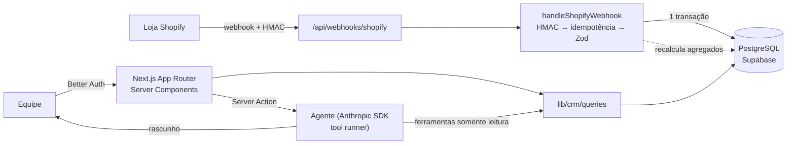

# Order Hub

**Shopify → CRM com agente de IA de retenção.** Recebe os pedidos de uma loja Shopify via
webhooks, grava em PostgreSQL com Prisma, calcula as métricas de CRM de cada cliente (LTV,
ticket médio, segmento _novo / recorrente / em risco_) e oferece um agente de IA que responde
perguntas como _"quais clientes estão em risco? escreva um e-mail de reativação"_ consultando o
banco por _tool calling_, sempre entregando rascunhos para revisão humana.

[](https://github.com/filipposemilia/order-hub/actions/workflows/ci.yml)


> Projeto construído para aprofundar Prisma em produção e o ecossistema de webhooks da Shopify,
> com o mesmo rigor de um sistema real: idempotência, transações, testes automatizados, CI,
> autenticação e LGPD.

---

## Funcionalidades

| Área                 | O que faz                                                                                                                                                                                                                                                       |
| -------------------- | --------------------------------------------------------------------------------------------------------------------------------------------------------------------------------------------------------------------------------------------------------------- |
| **Webhooks Shopify** | `orders/create`, `orders/updated`, `orders/paid`, `orders/cancelled`, `customers/create`, `customers/update`, `customers/redact`. Verificação HMAC no corpo bruto, idempotência por `X-Shopify-Webhook-Id`, transação única, descarte de eventos fora de ordem. |
| **CRM**              | LTV e ticket médio por cliente (usando `current_total_price`, que já reflete reembolsos), segmentação novo / recorrente / em risco / sem compras, filtros e busca server-side.                                                                                  |
| **Painel**           | Faturamento 30/90 dias, ticket médio, distribuição por segmento, produtos mais vendidos.                                                                                                                                                                        |
| **Agente de IA**     | Claude com 3 ferramentas somente leitura, minimização de dados pessoais, limite diário por usuário, auditoria de tokens e ferramentas em `agent_runs`.                                                                                                          |
| **Autenticação**     | Better Auth: e-mail/senha sem cadastro público + GitHub OAuth opcional com allowlist; rate limit no login.                                                                                                                                                      |
| **LGPD**             | `customers/redact` anonimiza o cliente e mantém só o histórico financeiro anônimo; o LLM nunca recebe e-mail/telefone.                                                                                                                                          |

## Arquitetura



Detalhes em [`docs/architecture.md`](docs/architecture.md) e nas decisões registradas em
[`docs/adr/`](docs/adr).

## Stack

| Camada    | Escolha                                                                 | Por quê                                                                                 |
| --------- | ----------------------------------------------------------------------- | --------------------------------------------------------------------------------------- |
| Framework | **Next.js 16** (App Router, Cache Components, `proxy.ts`)               | Front e back no mesmo deploy; Server Components consultam o banco sem API intermediária |
| Linguagem | **TypeScript strict** + **Zod 4**                                       | Tipos do banco ao componente; validação de env, payloads e Server Actions               |
| Banco     | **PostgreSQL** (Supabase, região São Paulo)                             | Relacional, transações, `Decimal` para dinheiro                                         |
| ORM       | **Prisma 7** (driver adapter `pg`)                                      | Schema declarativo, migrações versionadas, client tipado                                |
| Auth      | **Better Auth**                                                         | Sessões no próprio banco via adapter Prisma, sem vendor lock-in                         |
| IA        | **Anthropic SDK** (tool runner, Claude)                                 | Tool calling tipado com Zod, fallback de recusa no servidor                             |
| UI        | **Tailwind CSS 4**                                                      | Rápido, consistente, dark mode                                                          |
| Testes    | **Vitest** (unit + integração com Postgres real) · **Playwright** (E2E) | Pirâmide de testes que cobre o caminho crítico                                          |
| CI/CD     | **GitHub Actions** + **Vercel** (`gru1`)                                | Lint, tipos, 3 suítes de teste e build a cada PR; preview por PR                        |

## Rodando localmente

Pré-requisitos: Node 22+ e npm. **Não precisa de Docker**: o Postgres local é o `prisma dev`.

```bash
git clone https://github.com/filipposemilia/order-hub && cd order-hub
npm install
cp .env.example .env              # gere BETTER_AUTH_SECRET: openssl rand -base64 32
npm run db:dev                    # sobe o Postgres local (porta 51214)
npx prisma migrate deploy         # cria as tabelas
npm run db:seed                   # 160 clientes, ~440 pedidos e o usuário demo
npm run dev                       # http://localhost:3000
```

Login demo: `demo@orderhub.dev` / valor de `DEMO_PASSWORD` no `.env`.

Simule um webhook da Shopify assinado, sem loja real:

```bash
npm run webhook:send                                   # orders/create
npm run webhook:send -- --repeat 2                     # mesmo webhook 2x → {"duplicate":true}
npm run webhook:send -- --topic orders/updated --status refunded
```

Para conectar uma loja de desenvolvimento real: [`docs/shopify-setup.md`](docs/shopify-setup.md).
Para publicar na Vercel com Supabase: [`docs/deploy.md`](docs/deploy.md).

## Testes

```bash
npm run check             # lint + typecheck + testes unitários (40)
npm run db:test:start     # Postgres separado para testes
npm run test:integration  # pipeline de webhooks e consultas no banco real (21)
npm run test:e2e          # Playwright: login, filtros, detalhe, logout (8)
```

Os testes de integração cobrem os casos que quebram integrações em produção: entrega duplicada,
webhook fora de ordem, reembolso parcial e total, cancelamento, checkout sem cliente, payload
inválido (rollback) e anonimização LGPD.

## Decisões de engenharia

- **Dinheiro nunca é `float`**: `Decimal(12,2)` no banco, centavos inteiros em JS.
- **Agregados recalculados, não incrementados**: cada escrita de pedido recalcula LTV/contagem do
  cliente na mesma transação, então reentregas, reembolsos e eventos fora de ordem convergem.
- **Segmento derivado em tempo de consulta**: depende de "hoje", então não é gravado; a mesma regra
  existe como função pura (`segmentOf`) e como filtro Prisma (`segmentWhere`), ambas testadas.
- **Autorização perto dos dados**: `proxy.ts` só faz a checagem otimista do cookie; cada página,
  Server Action e rota valida a sessão com `requireUser()`.
- **IA com revisão humana**: o agente não escreve no banco nem envia nada; as respostas são
  rascunhos editáveis, e cada execução fica auditada com tokens, ferramentas e latência.

## Estrutura

```text
app/
  (app)/            páginas autenticadas: visão geral, clientes, agente
  api/              webhooks Shopify, Better Auth, health check
  login/
lib/
  shopify/          hmac, schemas Zod, ingestão idempotente, pipeline de webhooks
  crm/              regras de segmento, agregados, consultas
  agent/            ferramentas, prompt, execução
prisma/             schema, migrações, seed
tests/              unit · integration · e2e · fixtures
docs/               arquitetura, ADRs, setup Shopify, deploy, agente
.claude/            skills, subagente revisor e hooks do Claude Code
```

## Desenvolvimento com IA

O repositório é preparado para Claude Code: [`CLAUDE.md`](CLAUDE.md) com as invariantes do
projeto, skills para tarefas recorrentes (novo tópico de webhook, migração Prisma, ferramenta do
agente, entrega de PR, integrações brasileiras), um subagente revisor e hooks que formatam o
código e bloqueiam edições em `.env`, migrações aplicadas e código gerado. Todo código gerado
passa por revisão crítica e pelos testes antes do merge.

## Próximos passos

- Fila (Inngest/QStash) entre o recebimento do webhook e o processamento, para picos de volume
- Backfill de pedidos históricos via Admin GraphQL API
- Canais brasileiros: Mercado Livre, Bling e confirmação de Pix (notas em `.claude/skills/br-ecommerce-integrations`)
- Coortes de recompra e RFM; envio dos rascunhos aprovados para a ferramenta de e-mail

## Licença

MIT. Ver [LICENSE](LICENSE).
